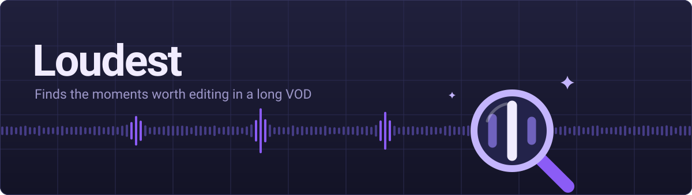

**[Download for Windows](https://github.com/ArChrisVa/Loudest/releases/latest)** &nbsp;·&nbsp; free &nbsp;·&nbsp; Windows 10 and 11

Loudest listens to an hours-long stream recording and finds the moments worth editing, so you jump between them instead of scrubbing.

## How it works

1. **Drop a VOD in.** A 4½-hour stream took a minute on our test PC.
2. **Go through what it found:** laughs, screams, shouts, raised voices, chat bursts. Keep the good ones.
3. **Export** them as markers for DaVinci Resolve or Premiere Pro, as YouTube timestamps, or as clips.

## Good to know

- Your videos stay on your PC.
- Paste the stream's YouTube or Twitch link to use its chat as well.
- **Installing:** Windows shows a blue warning for apps it does not know. Click **More info**, then **Run anyway**.

Built on FFmpeg and other open-source work. Their licences and source code: [THIRD-PARTY-NOTICES.txt](THIRD-PARTY-NOTICES.txt)
